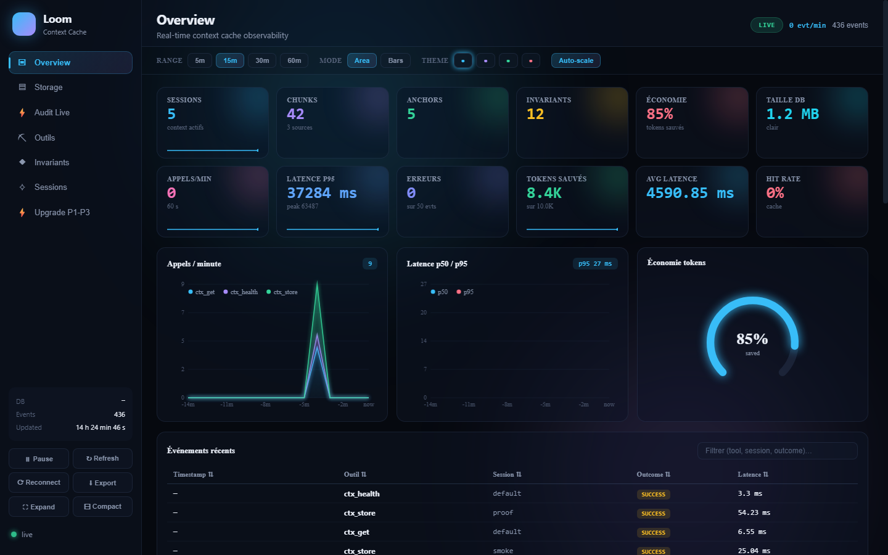

> ⚠️ **Note:** The rest of this repository (code, comments, scripts, docs, commits, issues) is written in **French**. Only this README is in English.

<div align="center">

<p align="center"></p>

[](https://github.com/MlkBlk-IT/mcp-loom-mcp/releases)

   

[](https://m8ven.ai/mcp/mlkblk-it-mcp-loom-19dcvu?s=readme) [](https://m8ven.ai/mcp/mlkblk-it-loom-41lyje?s=readme)

</div>

> ## ⚠️ WORK IN PROGRESS — NOT READY FOR PRODUCTION (updated 2026-10-26)
> Loom is under repair and being re-measured. **Do not use in production.**
> - **No token savings have been demonstrated to date.** The old figures (`saved_pct` 94–99%, `bench-report.json`, `bench_results.json`, `REPORT_FINAL.md`) measured the anchor size alone: they are **invalid**.
> - Current real measurement (LM Studio, small local models, small documents): Loom costs **more** tokens than the baseline (fixed anchor overhead + tool schemas). The large-context test with a cloud model has not been done yet.
> - Decision criterion frozen before the bench: same success rate with ≥ 35% fewer total tokens (in+out), retrieval and tool tax included. Otherwise: pivot or stop.
> - Code state (measured 2026-10-25, see [`PROGRESS.md`](PROGRESS.md)): **83 passed / 19 failed / 1 collection error** across 103 test functions in 20 files. Most failures come from a code refactor that was not followed by a test update, plus 4 real anchor regressions (`port` kind, rare kinds, dates). `verify`, `redact`, `audit` and `sandbox` exist and their tests pass.
> - The server exposes **17 MCP tools** — this section used to list 13. The tool table below is now the measured list.

> **"Weave the context without cutting the thread."**
> A portable MCP server that keeps the LLM context small by **moving** it out of the prompt — never by summarizing it.

---

## Dashboard



*Dashboard in `--demo` mode (`python dash/server.py --demo`, port set by `LOOM_DASH_PORT`, default 8775). The figures on screen (for example "85% saved") are **synthetic demo data, not measurements** — see the work-in-progress notice above.*

## Installation

> **The registry publication is pending.** The repository, the PyPI distribution and the npm package
> all carry the same name — **`mcp-loom-mcp`** — and the packages are built, tagged and ready to
> publish (`v0.1.3`). The names `mcp-loom` and `loom-mcp` belong to **other projects** on those
> registries — on PyPI a server for Loom's internal GraphQL API, on npm an unrelated DuckDB proxy —
> and a registry never releases a name. That is why the repository was renamed from `Mcp-Loom` (the
> old URL redirects automatically).
>
> The registry commands below are the final ones, but they return a 404 until the first publish.
> Install from source in the meantime:
> `pip install "mcp-loom-mcp @ git+https://github.com/MlkBlk-IT/mcp-loom-mcp.git"`.

```bash
# PyPI
uv tool install mcp-loom-mcp          # or: pip install mcp-loom-mcp

# npm
npx -y mcp-loom-mcp
```

| Registry | Package | Page |
|---|---|---|
| PyPI | `mcp-loom-mcp` | [pypi.org/project/mcp-loom-mcp](https://pypi.org/project/mcp-loom-mcp/) |
| npm | `mcp-loom-mcp` | [npmjs.com/package/mcp-loom-mcp](https://www.npmjs.com/package/mcp-loom-mcp) |

The package installs the `loom-mcp` console script (the server MCP clients spawn) and the `loom`
admin CLI. Point your MCP client at `loom-mcp`:

```json
{
  "mcpServers": {
    "loom": {
      "command": "loom-mcp"
    }
  }
}
```

### From source

```bash
pip install "mcp-loom-mcp @ git+https://github.com/MlkBlk-IT/mcp-loom-mcp.git"
```

### From source, with the dev extras

```bash
git clone https://github.com/MlkBlk-IT/mcp-loom-mcp.git
cd mcp-loom-mcp
python -m venv .venv
.\.venv\Scripts\Activate.ps1        # Windows
pip install -e ".[dev]"
```

### Admin CLI

The same operations are available on the command line, built on top of the MCP tools:

```bash
loom health      # drawer health status
loom stats       # token stats for a session
loom vacuum      # compact the SQLite drawer
loom search      # FTS5 search over stored chunks
```

### Transports

| Transport | Command | Target client |
|-----------|---------|---------------|
| **stdio** | `loom-mcp` | Claude Desktop, IDEs, any stdio client |

The HTTP transport (streamable-http) and token authentication are **not yet tested end to end**.

> Building and publishing this package: see [`PUBLISHING.md`](PUBLISHING.md).

---

## The problem

An LLM agent burns its tokens on bulky context: raw logs, 100 files read, tool outputs.
Loom takes that volume **out of the prompt** and files it in a local drawer. The model keeps
a short, dense anchor plus **stable IDs**. When it needs the detail, it asks Loom back —
**byte for byte**.

| Method | Loss |
|--------|------|
| **Move** (Loom) — "the log is in drawer #7" | **zero** — the content exists, retrievable |
| Summarize (the others) — "the log says the build failed" | possible loss — exact numbers vanish |

Loom moves nothing else. That is the whole thesis of the project.

---

## Current state

**v0.1.1 — working core, honest test state.** **17 MCP tools** exposed, a reproducible benchmark on
a 21-file corpus, and a test suite that is **not green**: 83 passed / 19 failed / 1 collection error
(measured 2026-10-25 — [`PROGRESS.md`](PROGRESS.md)). Phase 2 (HTTP transport, rate-limiting and audit
wired to the last 5 tools) in progress.

---

## Architecture

```
LLM context
     │
     │  ctx_store / ctx_store_file / ctx_store_cmd
     ▼
┌──────────────────────────────────────────┐
│  ANCHORING      anchors.py + compress.py │  ← extracted invariants, condensed anchor
│  REDUCTION      profile.py               │  ← strict / balanced / aggressive
│  GUARANTEE      verify.py                │  ← safety net: nothing disappears
│  ENCRYPTION     crypto.py                │  ← Fernet (column) / SQLCipher (DB)
│  REDACTION      redact.py                │  ← secrets masked before storage
│  TRUST          sandbox.py + ratelimit.py│  ← isolated execution + rate limiting
│  TRACEABILITY   audit.py                 │  ← structured JSONL logs
└──────────────────────────────────────────┘
     │
     │  SQLite + FTS5 (store.py)
     ▼
   LOCAL DRAWER  (~/.loom/loom.db)
```

### Modules

| Module | Role |
|--------|------|
| `server.py` | FastMCP server — 17 tools, thin layer, zero business logic |
| `anchors.py` | Invariant extractor (numbers, paths, URLs, versions, hashes, ports, constraints) |
| `compress.py` | Anchor + chunk construction, byte-identical guarantee |
| `store.py` | SQLite drawer + FTS5 index: chunks, anchors, invariants |
| `verify.py` | Coverage check — proof that nothing was lost |
| `profile.py` | 3 profiles: `strict` (zero-loss), `balanced`, `aggressive` (opt-in lossy) |
| `tokenizer.py` | Token counting (tiktoken `cl100k_base`, heuristic fallback) |
| `crypto.py` | Dual-mode encryption: SQLCipher (DB) or Fernet (columns) |
| `redact.py` | Secret masking (`Bearer`, `sk-`, `password=`, `secret=`, `token=`) |
| `sandbox.py` | Execution sandbox (Windows Job Object / bwrap-firejail Linux), fail-closed |
| `ratelimit.py` | Token bucket per session / IP |
| `audit.py` | structlog JSONL audit logs, 30-day rotation |
| `session.py` | UUIDv7 sessions, TTL, purge, isolation |

---

## Exposed MCP tools (17)

| Tool | Role |
|------|------|
| `ctx_store` | Moves bulky content into the drawer → anchor + IDs + savings report |
| `ctx_store_file` | Same, reading **server-side** (the volume never transits through the prompt) |
| `ctx_store_cmd` | Same, from a command — **opt-in** (`LOOM_STORE_CMD=1`) and sandboxed |
| `ctx_get` | Retrieves a chunk, byte for byte |
| `ctx_search` | FTS5 search over stored chunks → `chunk_id`, `score`, `snippet` |
| `ctx_check` | Verifies no critical invariant was lost (the safety net) |
| `ctx_verify` | Coverage verification, per session or global |
| `ctx_stats` | Tokens before/after, hit rate, ratio |
| `ctx_profile` | Switch profile: `strict` \| `balanced` \| `aggressive` |
| `ctx_list_sessions` | Lists sessions (including expired) |
| `ctx_purge_session` | Purges one session |
| `ctx_purge_expired` | Purges expired sessions (TTL) |
| `ctx_transfer` | Transfers chunks between two sessions |
| `ctx_vacuum` | Compacts the SQLite database |
| `ctx_rebuild_index` | Rebuilds the search index |
| `ctx_vector_stats` | Statistics of the vector index |
| `ctx_health` | Drawer health status |

Administration operations (`purge`, `vacuum`, `health`, `list_sessions`) are also available
as CLI: `python -m loom <cmd>`.

---

## Profiles

| Profile | Behavior | Loss |
|---------|----------|------|
| `strict` | Widened anchor, all invariants visible | **none** — default mode |
| `balanced` | Tightened anchor, priority invariants kept | none on stored content |
| `aggressive` | Minimal anchor | the anchor becomes lossy — **explicit opt-in, always reported** |

---

## Metrics — and what they actually mean

This is the most important part of the project: badly named metrics make a benchmark lie.
Here is the exact meaning of each measure.

| Metric | Definition | What it does not say |
|--------|------------|----------------------|
| `saved_pct` | Tokens **saved in the anchor** (what the model sees in context) | Not the total stored volume — chunks are on demand |
| `coverage` | Fraction of invariants **visible in the anchor** without retrieval | 25% coverage is not a loss: the rest is retrievable |
| `retrievable` | Fraction of content **retrievable via chunks** | Always `1.0` in the measurements below |
| `lossless` | No critical invariant lost | Verified by `verify.py`, not assumed |
| `gain_net` | (anchor tokens + needed chunk tokens) / original tokens | Measured on 10 planted facts per file |
| `identical` | *Legacy field, not tracked since bench v2* | Always `false` in `bench_results.json` — do not read proof into it |

---

## Proven feasibility — measured benchmark

**Corpus**: 21 real files (6.87 MB — code review, config, incident, doc, analysis, session,
migration) × 3 sizes × 3 profiles = **63 measurements**, 1,405,483 tokens processed per
profile. Tokenizer `tiktoken:cl100k_base`. Corpus reproducible via `scripts/make_dataset.py`.

### Averages per profile (21 files)

| Profile | Tokens saved | Anchor coverage | Compression latency | Retrieval | Lossless | Critical invariants lost |
|---------|--------------|-----------------|---------------------|-----------|----------|--------------------------|
| `strict` | **83.33%** | 67.04% | 144.6 ms | 28.7 ms | ✅ | **0** |
| `balanced` | **89.55%** | 53.84% | 144.9 ms | 28.6 ms | ✅ | **0** |
| `aggressive` | **94.17%** | 40.77% | 145.1 ms | 28.0 ms | ✅ | **0** |

`retrievable = 1.0` and `critical_missing_retrievable = 0` across **all 63 measurements**.

### Breakdown by size

| Profile | Small (13.6 k tok.) | Medium (168.3 k tok.) | Large (1,223.6 k tok.) |
|---------|---------------------|-----------------------|------------------------|
| `strict` | 56.68% · 99.34% cov. · 4.4 ms | 94.33% · 76.78% cov. · 52.7 ms | 98.99% · 24.99% cov. · 376.7 ms |
| `balanced` | 72.51% · 94.56% cov. · 4.4 ms | 96.54% · 56.29% cov. · 53.1 ms | 99.60% · 10.68% cov. · 377.4 ms |
| `aggressive` | 84.29% · 80.03% cov. · 4.4 ms | 98.37% · 38.16% cov. · 52.7 ms | 99.86% · 4.12% cov. · 378.2 ms |

**Reading**: latency is dominated by invariant extraction (regex), not by anchor size —
hence near-identical latencies across profiles on the same file. On a 1.2 M-token file, the
`strict` anchor drops to **~25% visible coverage** but **100% of the content stays
retrievable**: exactly the intended trade-off.

### Reproduce

```bash
.venv/Scripts/python.exe bench_dataset.py   # → bench_results.json (63 measurements)
```

---

## Proven artifacts

| Artifact | File | Proof |
|----------|------|-------|
| MCP server | `src/loom/server.py` | 17 tools, 416 lines |
| Safety net | `src/loom/verify.py` | coverage + invariants not lost |
| Encryption | `src/loom/crypto.py` | PBKDF2-HMAC-SHA256 600k iterations → Fernet (AES-128-CBC + HMAC) |
| Sandbox | `src/loom/sandbox.py` | Windows Job Object (CPU, RAM, process count) / bwrap Linux |
| Redaction | `src/loom/redact.py` | 5 pattern families, `LOOM_REDACT=1` by default |
| Corpus | `dataset/` | 21 files, 6.87 MB, 7 types × 3 sizes |
| Benchmark | `bench_results.json` | 63 measurements, real tokenizer |
| Tests | `tests/` | 103 test functions in 20 files — 83 pass, 19 fail, 1 collection error |

---

## Test suite

**The suite is not green.** Measured on 2026-10-25 — full breakdown in [`PROGRESS.md`](PROGRESS.md):

```
$ .venv/Scripts/python.exe -m pytest -q --ignore=tests/test_allowed_dirs.py
103 test functions in 20 files  ->  83 passed, 19 failed
```

- **1 collection error** — `tests/test_allowed_dirs.py` imports `loom.server._path_allowed`, a helper
  that was replaced by an inline `LOOM_ALLOWED_DIRS` check. The test is stale, the code is newer.
- **19 failures** — 15 come from a code refactor that was not followed by a test update (renamed
  APIs, removed kwargs, the tool list growing from 13 to 17), and **4 are real anchor regressions**
  (`port` kind no longer produced, rare kinds no longer reaching the `strict` anchor, dates still
  extracted as numbers).
- `verify`, `redact`, `audit` and `sandbox` exist and their tests pass.

### The safety-net subset (green)

| File | Tests | Guarantee |
|------|-------|-----------|
| `test_safety_net.py` | 16 | Byte-identical chunks, `strict` not lossy, edge-case coverage |
| `test_anchor_vectors.py` | 9 | Invariant extraction on reference vectors |
| `test_compress_anchor.py` | 4 | Anchor + chunk construction, invariant budget |
| `test_roundtrip.py` | 4 | Store → retrieve byte-identical on a real SQLite drawer |
| `test_server_integration.py` | 4 | Full MCP round-trip (store/get/check/profile) |
| `test_stdio_server.py` | 1 | The server actually responds over STDIO transport |

**3 real bugs found by the tests** (they would never have surfaced otherwise):

1. `FastMCP 4.x` no longer accepts `readOnlyHint=` as a kwarg → worked around with `annotations=ToolAnnotations(...)`.
2. `chunk_id` typed `int` while MCP clients send **strings** → tolerant `str | int` signature.
3. Chunk splitting was losing bytes (`strip("\n")`) → broke the "byte-identical" promise. Fixed, with safety net + parameterized test cases.

---

## Configuration (environment variables)

| Variable | Default | Effect |
|----------|---------|--------|
| `LOOM_DB` | `~/.loom/loom.db` | SQLite drawer path |
| `LOOM_DB_PASSWORD` | *(empty)* | Enables encryption (Fernet or SQLCipher) |
| `LOOM_REDACT` | `1` | Secret masking (`0` = disabled) |
| `LOOM_STORE_CMD` | `0` | Enables `ctx_store_cmd` (sandboxed) |
| `LOOM_TTL_DAYS` | `30` | Session expiry |
| `LOOM_RATE_LIMIT` | *(on)* | Token bucket per session / IP |
| `LOOM_RPM` / `LOOM_BURST` | — | Token-bucket rate and burst |
| `LOOM_LOG_LEVEL` | `INFO` | Log verbosity |

---

## Known limitations

- `ctx_store_cmd` is not sandboxed on every platform: it **refuses** to run if no sandbox is available (fail-closed).
- Redaction breaks byte-identity of masked zones — an accepted trade-off, reported in the report.
- No full database encryption on Windows: SQLCipher has no prebuilt wheel (C build failure) → fallback to column-level Fernet, with the FTS5 index remaining in clear for search.
- `chmod 600` is ignored on NTFS → protect the drawer directory manually.
- HTTP transport (streamable-http) and token authentication are not yet tested end to end.
- Rate-limiting and audit are wired to 8 of the 17 tools; 9 remain to be wired.

---

## Methodology

- **Safety net first**: the invariant extractor and verifier were written *before* the compression logic. If the verifier cannot prove something survived, the tool refuses to compress.
- **Deterministic extraction**: regex and heuristics only, never an LLM. A verifier that depends on an LLM cannot *prove* coverage.
- **Honest measurement**: every report gives before/after tokens **counted by a real tokenizer**, never estimated.
- **Audit before action**: reproducible benchmark, versioned corpus, per-session report in `docs/`.
- **Portable by construction**: SQLite + FTS5, no proprietary SDK, no paid API.

---

## What this project demonstrates

1. **Moving ≠ summarizing** — lossy compression is a choice, not a technical necessity. Loom proves it with `retrievable = 1.0` across 63 measurements.
2. **The token budget is an architecture problem, not a prompt problem** — the right answer is an indexed local drawer, not a shorter prompt.
3. **Honest metrics do more work than flattering metrics** — naming `coverage` "visible in the anchor" instead of "covered" prevents a benchmark that lies.
4. **An AI project can be 100% CPU and 100% local** — Python + SQLite, no GPU, no paid API.

---

## Author

**Malik** — IT Support student (DEP), self-taught
Focus: Sysadmin + Cyber + AI + Cloud


## Ownership and license

[Project origin and evidence](PROJECT-ORIGIN.md) · [License](LICENSE)

---

<div align="center">


**⚡ Built on CPU. Proven on disk. ⚡**

</div>


---

<div align="center">

<sub>Original project and documentation by <strong>Malik Belkacemi · MLKBLK-IT</strong> · © 2026</sub>

</div>
